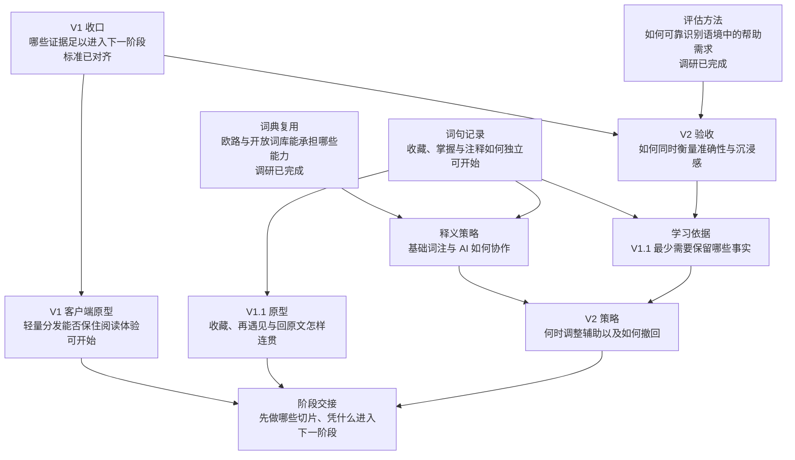

# Wise Reader · V1→V2 路线图发布快照

2026-10-09。用户已批准具体拆分并授权发布。[Wise Reader · V1→V2 决策地图](https://github.com/Coraia/EasySink/issues/23) 及 **11 张决策票、13 条原生依赖均已发布并回读核对**。GitHub 是后续决策的持续维护入口；本文件保留已批准范围，并于同日更新两项调研完成、V1收口标准定稿及客户端原型发布状态。

## 目的地与已确认边界

把 V1 的收口标准、V1.1 的词典与词句留存闭环、V2 的个性化辅助目标及验收方法说清楚，并确定阶段依赖与规格交接。地图的完成条件是路线清晰，不是产品已经开发或验收。

本会话确认记录：

| 对齐点 | 用户已接受的边界 |
| --- | --- |
| Q1 地图终点 | 规划 V1 → V1.1 → V2，能够据此进入规格和开发；本次只建决策地图。 |
| Q2 V1 收口 | 保留既定验收；优先处理阅读阻断、数据损坏、错误服务调用和明显性能退步，记录其余问题。 |
| Q3 V1.1 闭环 | 释义更好 → 带语境收藏词句 → 再次遇见 → 回原文；欧路与开放资源先调研。 |
| Q4 意图区分 | 收藏、掌握反馈、保留注释独立；历史操作保持来源与不确定性。 |
| Q5 V2 成功标准 | 在相近注释密度、释义质量与性能条件下改善语境帮助需求判断；兼顾漏标、多标、释义错误与打断。 |
| Q6 最小依据 | 在 V1.1 保留明确反馈、查阅及可选校准的最小事实与语境，默认本地；不以查阅、收藏或无操作直接推断掌握。 |

这些是建图之前确认的范围，放入地图 Notes。新地图的 Decisions so far 初始为空；不能通过人工创建并关闭若干票来伪造已经走过决策过程。

## 产品阶段

这是体验版本顺序，不是串行排班。调研、领域决策、原型可以并行；正式接入与放行仍受各阶段真实验收约束。暂不编造完成日期、F1 目标或性能阈值，先保留既定承诺并测定可复现基线。

## 决策依赖图

每个节点是一张问题票，关闭意味着问题已决定，而不是功能已实现。箭头表示后者需要前者的决定；“可开始”表示没有地图内前置决策，HITL 票仍需用户参与。

## 决策票审阅清单

标题链接打开 GitHub 中的完整决策问题。类型通过 wayfinder 标签表达，不使用 ready-for-agent。

| 决策票 | 方式 | 直接前置决定 |
| --- | --- | --- |
| [V1 收口：哪些证据足以进入下一阶段](https://github.com/Coraia/EasySink/issues/24) | 对齐 · 已完成 | 标准已定稿，产品仍待验收 |
| [词典复用：欧路与开放词库能承担哪些能力](https://github.com/Coraia/EasySink/issues/25) | 调研 · 已完成并归档 | 无；研究票已关闭 |
| [评估方法：如何可靠识别语境中的帮助需求](https://github.com/Coraia/EasySink/issues/26) | 调研 · 已完成并归档 | 无；研究票已关闭 |
| [词句记录：收藏、掌握与注释如何独立](https://github.com/Coraia/EasySink/issues/27) | 对齐 · 用户决定 | 无，可开始 |
| [释义策略：基础词注与 AI 如何协作](https://github.com/Coraia/EasySink/issues/28) | 对齐 · 用户决定 | [词典复用：欧路与开放词库能承担哪些能力](https://github.com/Coraia/EasySink/issues/25)；[词句记录：收藏、掌握与注释如何独立](https://github.com/Coraia/EasySink/issues/27) |
| [V2 验收：如何同时衡量准确性与沉浸感](https://github.com/Coraia/EasySink/issues/29) | 对齐 · 用户决定 | [V1 收口：哪些证据足以进入下一阶段](https://github.com/Coraia/EasySink/issues/24)；[评估方法：如何可靠识别语境中的帮助需求](https://github.com/Coraia/EasySink/issues/26) |
| [学习依据：V1.1 最少需要保留哪些事实](https://github.com/Coraia/EasySink/issues/30) | 对齐 · 用户决定 | [词句记录：收藏、掌握与注释如何独立](https://github.com/Coraia/EasySink/issues/27)；[V2 验收：如何同时衡量准确性与沉浸感](https://github.com/Coraia/EasySink/issues/29) |
| [V1.1 原型：收藏、再遇见与回原文怎样连贯](https://github.com/Coraia/EasySink/issues/31) | 原型 · 用户验收 | [词句记录：收藏、掌握与注释如何独立](https://github.com/Coraia/EasySink/issues/27) |
| [V2 策略：何时调整辅助以及如何撤回](https://github.com/Coraia/EasySink/issues/32) | 对齐 · 用户决定 | [释义策略：基础词注与 AI 如何协作](https://github.com/Coraia/EasySink/issues/28)；[学习依据：V1.1 最少需要保留哪些事实](https://github.com/Coraia/EasySink/issues/30) |
| [阶段交接：先做哪些切片、凭什么进入下一阶段](https://github.com/Coraia/EasySink/issues/33) | 对齐 · 用户决定 | [V1.1 原型：收藏、再遇见与回原文怎样连贯](https://github.com/Coraia/EasySink/issues/31)；[V2 策略：何时调整辅助以及如何撤回](https://github.com/Coraia/EasySink/issues/32)；[V1 客户端原型：轻量分发能否保住阅读体验](https://github.com/Coraia/EasySink/issues/34) |
| [V1 客户端原型：轻量分发能否保住阅读体验](https://github.com/Coraia/EasySink/issues/34) | 原型 · 待体验 | [V1 收口：哪些证据足以进入下一阶段](https://github.com/Coraia/EasySink/issues/24)（已完成） |

两项研究和V1收口标准对齐已完成。词句记录、V2验收口径与客户端原型处于不同的可推进分支；HITL决定及原型结论仍由用户确认，代理不替用户回答。

**V1.1 原型：收藏、再遇见与回原文怎样连贯** 只依赖词句记录语义，允许使用明确标注的占位内容，避免被词典研究拖住；正式释义能力必须等对应策略与实测。

**阶段交接：先做哪些切片、凭什么进入下一阶段** 汇总前面的决定；某一阶段已有足够依据时可以单独进入后续规格流程，不把全部 V2 研究当作 V1.1 开发的硬阻塞。

## 地图之外与尚未展开

范围内的未知：词库样本或真实试用可能暴露的特殊语境、表达和来源问题；配对评价发现当前候选策略不能解释的误标、漏标与打断。出现具体反例后再创建问题明确的新票。

范围外：本次直接开发/迁移/部署，整书翻译，云账号同步，排行榜，复杂背词计划，原生阅读内核重建，以及长期学习成效证明。它们不伪装成默认必做的后续阶段。

## 与当前工程的连接

- 当前阅读/PDF 基线为提交 9a8b46a 加本地连续阅读与导入就绪修复；[本轮证据](64-pdf-continuity-readiness.md) 只证明其实际覆盖的场景。
- [PDF T21：整体 review、完整走查 与一期发布验收](https://github.com/Coraia/EasySink/issues/22) 当前仍打开。本地图制定收口依据，既有执行验收留在原票，不自动关闭或重建。
- 现有词典返回缺少稳定义项身份；掌握判定覆盖旧值；“保留注释”写 unknown；笔记和书签不能直接等同无需输入想法的词句收藏。这些代码事实解释相关问题为什么存在，不预选实现。
- 已将接受的“词句收藏”“掌握反馈”“语境帮助需求”写入 [GLOSSARY](../GLOSSARY.md)，明确“保留注释”不等于“不认识”。代码尚未据此改变。

## 发布与接续

- [正式决策地图](https://github.com/Coraia/EasySink/issues/23) 是持续维护入口。[地图正文快照](wayfinder/v1-v2/map.md)、[发布清单](wayfinder/v1-v2/manifest.json) 与本页用于追溯本轮发布。
- 初次发布的10张票/11条依赖证据位于 outputs/wayfinder-v1-v2-publication-20261009/verification.json；本次扩展为11张票/13条依赖，回读证据位于 outputs/wayfinder-v1-gate-20261009/final-publication-verification.json。已关闭两张研究票和V1标准对齐票，既有PDF执行验收状态不因这些决策关闭而改变。
- 开始下一张票时，加载地图、查询开放且未领取且无阻塞的子问题，先领取再推进。V1收口标准已完成，不再重复领取；客户端原型已具备前置决定。
- grill-with-docs 等同于 grilling + domain-modeling；它是 Wayfinder 对齐票的内部工作方式，无需额外重复整轮访谈。研究票负责查证，原型票负责让用户实际判断交互。
- 某阶段问题已经决定、原型与验收方式明确后，可单独进入 to-spec 汇总规格，再以 to-tickets 拆成可独立演示的开发切片。拆票仍需审阅粒度和依赖；已确认的同一验收入口直接沿用，不重复索取授权。
- 现有规格与开发票已齐备的修复可以从原票继续实施及验收。V1.1 无需等待全部 V2 决策完成；新增且仍有分歧的能力不能把决策票直接当作开发票。
- 2026-10-09 用户安装 research 后，已并行完成两项研究、复核来源与证据边界，报告推送至独立研究分支；两张研究票已留下 resolution 并关闭，地图已索引结论。产品选型及验收口径仍留待用户决定。研究状态与产物见 GitHub 票及本地发布清单。prototype 的独立技能仍待执行原型票前核对；不影响当前研究。
- 本轮只发布并核验计划与文档，未改产品行为或执行产品测试。

- V1收口对齐新增客户端分发探索，用户已接受先验证最小macOS客户端原型。验收依据见 [V1 收口最终决定](https://github.com/Coraia/EasySink/issues/24#issuecomment-6077370532) 和 [验收矩阵](69-v1-release-gate.md)；[客户端原型](https://github.com/Coraia/EasySink/issues/34) 已发布，尚未实现。复用Web核心、优先系统WebView探索已确认；最终框架与客户端新增数值预算待原型实测。
- V1已进入to-spec，发布 [V1收口补充规格：阅读质量、性能与最小macOS客户端验证](https://github.com/Coraia/EasySink/issues/35)，标签为ready-for-agent；[本地规格快照](70-v1-closeout-spec.md)。它复用已确认业务走查入口及既有PDF规格/任务，不是新的Wayfinder子问题，也没有关闭客户端原型或发布验收。后续to-tickets仅审阅新增工作和实际缺口，避免重复开票。
