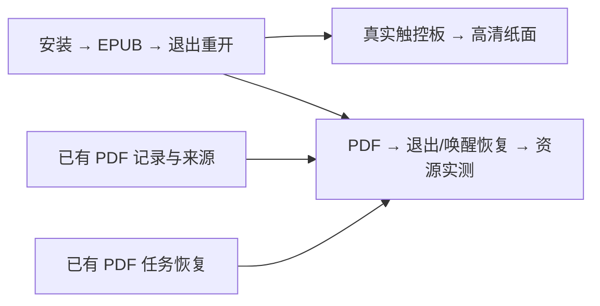

# V1 收口：增量任务拆分与发布记录

2026-10-09。来源：[V1 收口补充规格：阅读质量、性能与最小 macOS 客户端验证](https://github.com/Coraia/EasySink/issues/35)。用户已批准并调用 implement；三张新票、四条原生阻塞边和11条旧票补充评论已发布并回读，父规格正文及状态保持。开发已经开始，发布不代表任何验收项通过。

执行入口：[安装与续读 #36](https://github.com/Coraia/EasySink/issues/36)、[原生触控板 #37](https://github.com/Coraia/EasySink/issues/37)、[PDF 生命周期与资源 #38](https://github.com/Coraia/EasySink/issues/38)。准确发布身份及评论链接在下述清单；原审批草案保留供追踪。

建议只新增三张客户端执行票，复用全部已有 PDF 任务。它们是可安装原型的纵向交付，不是正式发行选型，也不按前端/后端/测试拆开。机器清单、故事映射和旧票补充正文见 [草案清单](tickets/v1-closeout-drafts/manifest.json)。

## 新增三张执行票

1. **[客户端安装、EPUB 阅读与重开续读](tickets/v1-closeout-drafts/issues/01-client-first-read.md)**
   - Blocked by：无，可在本拆分批准并发布后开始。
   - 交付：安装候选应用 → 导入 EPUB → 专注阅读/基础词注/选区笔记 → 退出重开续读；不要求用户准备开发环境或先启动服务。
   - 运行时、必要词库、隔离资料目录、基本端口与进程所有权随这条完整路径交付；不另设横向“打包底座”票。
2. **[客户端真实触控板与高清纸面](tickets/v1-closeout-drafts/issues/02-client-native-paper.md)**
   - Blocked by：客户端安装、EPUB 阅读与重开续读。
   - 交付：真实手势跟手、接触停驻、抬手收尾、回滑取消、连续/交替和高清纸面；原生事件接入、安装产物和真实设备证据形成闭环。
   - 使用固定 EPUB/已有阅读内容验证宿主输入与渲染，不等待扫描质量或付费增强；PDF Web纸面回归仍由旧票承担。
3. **[客户端 PDF 阅读、退出恢复与资源成本](tickets/v1-closeout-drafts/issues/03-client-pdf-lifecycle.md)**
   - Blocked by：客户端安装、EPUB 阅读与重开续读；[文字与原图笔记、书签和续读](https://github.com/Coraia/EasySink/issues/12)；[独立任务的暂停、取消、重启与恢复](https://github.com/Coraia/EasySink/issues/14)。
   - 交付：真实 PDF 导入/阅读/原版核对/记录 → 后台处理 → 休眠或退出 → 重开恢复；记录完整资源成本及进程树测量，不重做引擎、记录或任务系统。
   - 两个旧前置分别保证 PDF 记录/来源和任务恢复合同，不能因为源码存在就视为已完成。原始来源往返通过记录票的既有依赖传递，不额外重复阻塞。

共新增四条原生阻塞边：第1票→第2票、第1票→第3票、旧记录票→第3票、旧任务恢复票→第3票。这里的草案序号不会作为 GitHub issue 号使用。

第2、3票在各自前置满足后可并行。最终客户端方向和新增预算仍由 [客户端原型决策](https://github.com/Coraia/EasySink/issues/34) 收集三个产物并由用户体验确认，不新建第四张同义的“客户端验收”票。该决策不是执行票的前置关闭条件，避免“等原型通过才允许制作原型”的循环。暂不变动其已批准的地图原生依赖。

## 已有任务如何接续

2026-10-09实时读取的21张旧PDF票仍全部OPEN，均已保存正文、评论和原生前置快照。开放不等于没有代码，代码存在也不等于逐项验收完成。执行前先把当前代码、定向证据、仍缺条件对应回原票；只在全部适用标准有依据时关闭，不能为打开并行前沿批量标完成。

| 工作 | 复用现有任务 | 本轮补充与可演示结果 |
| --- | --- | --- |
| 旧书与数字PDF基础 | [旧书兼容](https://github.com/Coraia/EasySink/issues/2)、[数字PDF闭环](https://github.com/Coraia/EasySink/issues/3) | 核对已有真实入口及证据；不重新搭一个空实验产品。EPUB/TXT/Markdown和真实数字内容可读且资料隔离。 |
| 英文扫描书速度和质量 | [扫描PDF OCR](https://github.com/Coraia/EasySink/issues/4)、[顺序与来源](https://github.com/Coraia/EasySink/issues/6)、[转换方案与门槛](https://github.com/Coraia/EasySink/issues/7) | 主样本换196页英文书；文字层导入与真实图像OCR分开；180秒、98%正文抽检、30段/5000字符参考与覆盖/错序分类按补充规格取证。旧566页首失败保留。 |
| 复杂结构 | [公式/表格/原图回退](https://github.com/Coraia/EasySink/issues/5)、[渐进阅读版](https://github.com/Coraia/EasySink/issues/9) | 论文及补充类别的结构就地保留并可核对，不把普通正文图像化算识别达标。 |
| 导入服务与进度 | [正式导入](https://github.com/Coraia/EasySink/issues/8)、[渐进阅读版](https://github.com/Coraia/EasySink/issues/9) | 服务就绪/忙/切换、提交及执行前复查、导入或书架实际进度；离开面板仍有书，阅读版就绪后正确打开。 |
| 学术论文理解辅助 | [查词、译文、语法和发音](https://github.com/Coraia/EasySink/issues/11) | 固定arXiv:2609.36322v1，核对术语、公式/图注附近选区译文和双色对应高亮、位置保持、复用；分开归因提取、模型与UI问题。 |
| 来源与记录 | [来源往返](https://github.com/Coraia/EasySink/issues/10)、[PDF记录](https://github.com/Coraia/EasySink/issues/12)、[安全静默更新](https://github.com/Coraia/EasySink/issues/13) | 原页核对、记录完整生命周期、重排/改字不丢失或错绑；歧义保留。客户端复用其对外行为。 |
| 长任务与资料 | [任务恢复](https://github.com/Coraia/EasySink/issues/14)、[书籍回收恢复](https://github.com/Coraia/EasySink/issues/15)、[资料与开关](https://github.com/Coraia/EasySink/issues/19) | 暂停/取消/重启/迟到结果、回收恢复、空间不足与缓存清理有一致结果；原资料不被误删。 |
| 一个真实局部图像服务 | [局部外部增强与复用](https://github.com/Coraia/EasySink/issues/16) | 当前关闭且拒绝区域输入；补齐指定页/区域→实际调用→安全更新→有效结果复用，按明确试用范围和预算执行。 |
| 费用与恢复 | [并发限额与未知结果](https://github.com/Coraia/EasySink/issues/17) → [本地重放与重新生成](https://github.com/Coraia/EasySink/issues/18) | 继承已有真实前置；未知不盲重发，重放零新调用，主动生成是新尝试。不再拆同义费用票。 |
| 性能与连续纸面 | [后台性能](https://github.com/Coraia/EasySink/issues/20)、[高清纸面与真实翻页](https://github.com/Coraia/EasySink/issues/21) | 空闲/真实负载配对、慢中快/取消/连续/交替与跨就绪范围；复核已有修复，保存全部原始序列和真实设备证据。 |
| 总体验收 | [整体review与发布验收](https://github.com/Coraia/EasySink/issues/22) | 延续原末端前置，覆盖PDF-01..16及旧阅读全链；客户端结论另外依赖真实原型体验。不新增重复总验收票。 |

为11张确有新材料/门槛/接续要求的旧票准备补充评论，见草案清单。其余旧票沿用现有正文，执行时按新规格核对。此次不调整原有27条依赖，不搬迁旧票到新父规格，不修改或关闭任何父规格。

## 前置核查与并行边界

- **不新增全库预重构票。** 当前启动依赖开发运行时、固定服务位置；原生桥接现场编译并限制前台应用。运行时/路径配置随第1票完成，原生接入随第2票完成，资料/生命周期组合随第3票完成；仅在这些纵向路径内做必要适配。
- **旧票接续不是从零重做。** 现有主控授权已覆盖“必须停在旧实验入口等单独演示”的早期执行顺序，质量和实际验收门槛仍保留。优先回读适用证据，补确有缺口的场景，不靠改票名消除失败。
- **并行要满足真前置。** 新客户端第1票可以独立于PDF收口开始。第2票无需等待外部增强或OCR全书质量；第3票等待原记录/恢复合同完成。已有PDF链按其原生前置继续，候选准备不等于可以忽略OPEN依赖交付。
- **避免共享文件与设备抢占。** 启动/宿主、原生输入、PDF生命周期由不同切片负责；共享阅读核心的改动经主控协调。实际浏览器、真人触控板及同一GPU性能测量排队独占，不能同时运行造成证据污染。编码和静态检查可并行，性能基线不能并发重负载。
- **预算与框架由真实原型收口。** 第3票的资源初测可与第2票并行；合并原生接入后要复核受影响的资源成本，再在既有客户端决策内确认预算。三票通过不会自动关闭该HITL决策或宣布正式发行。

## 发布前校验与下一动作

草案必须覆盖补充规格60条用户故事，检查新增依赖无环、无冗余直接边、每票均有可直接演示的端到端行为。仅做文档/依赖核查，不运行产品测试或改动产品代码。

用户确认后：

1. 按前置顺序发布三张`ready-for-agent`子任务到补充规格，回读标题、全文与标签。
2. 创建原生父子关系及四条批准的阻塞边；发布时把草案名称换为真实issue身份，正文不留伪编号。
3. 将准备好的补充内容作为11张既有任务的评论接续；保留原正文、历史证据、父子关系及依赖，不批量关闭旧票。
4. 回读关系与评论，保存发布清单；父规格正文及状态不变。本轮没有额外授权迁移资料、付费调用或跳过实际验收。

需要用户确认的是**三张新增票的粒度、四条前置边以及复用旧票的安排**。已接受的产品要求与验收入口不再重新访谈。
